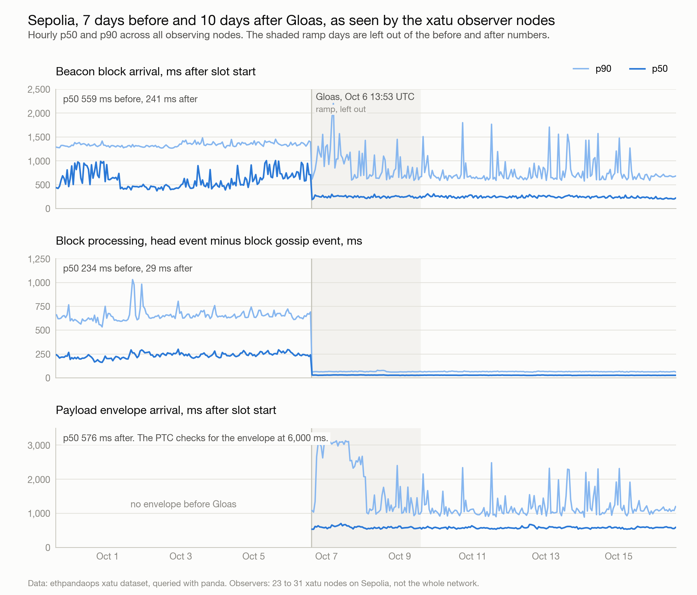
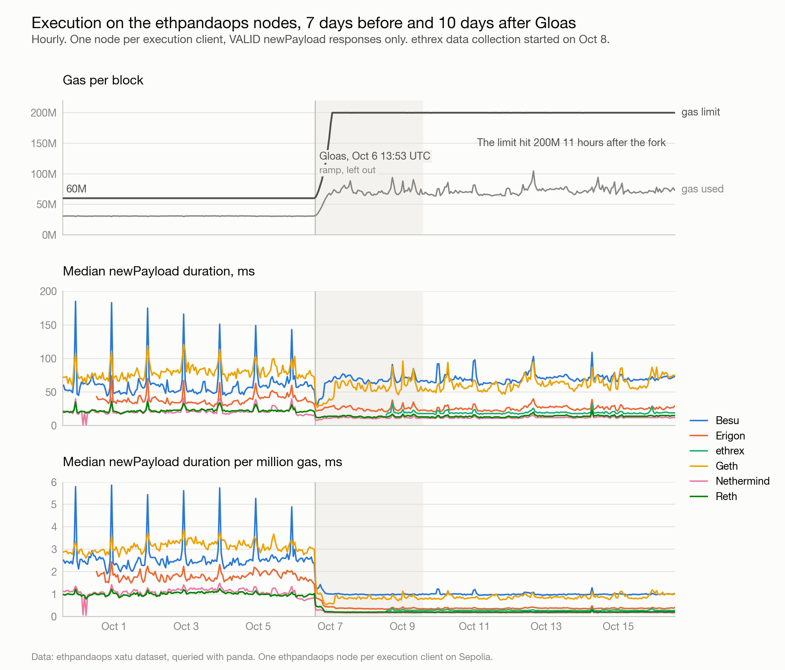
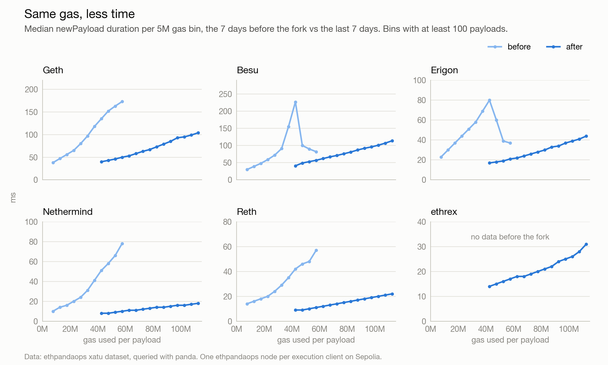

The [first post](/writing/very-early-glamsterdam-scaling-results/) looked at the nine hours after Glamsterdam activated on Sepolia, at slot 11,296,768 on 6 October 2026. The gas limit has now been at 200 million for over a week. This post reviews the scaling results again. It also covers payload envelope arrival and execution time per client, which the first post did not.

We compare the seven days before the fork with the last seven days, up to 13:53:36 UTC on 16 October. The three days in between, which include the gas limit ramp, are left out.

Thanks to ethpandaops for the data. They run one Sepolia node per execution client, Besu, Erigon, ethrex, Geth, Nethermind and Reth, and log every `newPayload` call. That gives us the execution time of every payload on each client, before and after the fork. ethrex data collection started on 8 October, so there is no ethrex data from before the fork.

The gas limit started rising at the fork and reached 200 million at 00:54 UTC on 7 October, 11 hours later. Average gas used per block went from 30.7 million to 72.0 million, an increase of 134%. Blocks are about 36% full.

Start with the beacon block again. Its median arrival time fell from 559 to 241 ms after slot start.

| Beacon block arrival | Before, ms | After, ms |
| --- | --- | --- |
| p50 | 559 | 241 |
| p90 | 1,331 | 678 |
| p99 | 2,289 | 2,415 |

The median fell by 56.9%, and every consensus client in the data had a lower median. p90 fell by about half. p99 did not improve, the same as in the first nine hours. The before median is lower than the 724 ms in the first post. This window covers a week instead of nine hours, with 31 observing nodes instead of 24.

Block processing stays low as well. The interval from the block gossip event to the head event fell from 234 to 29 ms p50, from 652 to 66 ms p90, and from 1,275 to 174 ms p99. Every consensus client was faster.

The first post did not look at the payload. With [ePBS](https://eips.ethereum.org/EIPS/eip-7732), the payload travels separately in a signed envelope, so it has its own arrival time. The PTC votes that the payload is present if the envelope was seen before 6 s into the slot.

| Payload envelope arrival | All, ms | Self-built, ms | Builder, ms |
| --- | --- | --- | --- |
| p50 | 576 | 579 | 574 |
| p90 | 1,081 | 2,530 | 929 |
| p99 | 2,955 | 3,490 | 2,151 |

The median envelope arrives 576 ms after slot start, 335 ms after the beacon block. Even p99, at 2,955 ms, is about 3 s before the PTC deadline. In the last seven days, 21,664 slots were self-built and 28,320 used one of nine builders. Both arrive at about the same median, but self-built payloads have a much longer tail, 2,530 ms at p90 compared with 929 ms for builder payloads. We have not looked into why. The median envelope is 83,220 bytes on gossip.

On the execution side, the median `newPayload` duration fell from 44 to 26 ms on the five clients that ran on both sides of the fork. Average gas used per payload rose 134% over the same period.

| `newPayload` duration | Before, ms | After, ms |
| --- | --- | --- |
| p50 | 44 | 26 |
| p90 | 114 | 82 |
| p99 | 281 | 252 |

Per client, the results differ more.

| Execution client | p50 before, ms | p50 after, ms | Per Mgas before, ms | Per Mgas after, ms |
| --- | --- | --- | --- | --- |
| Besu | 60 | 69 | 2.52 | 0.99 |
| Erigon | 38 | 25 | 1.81 | 0.36 |
| ethrex | n/a | 19 | n/a | 0.27 |
| Geth | 80 | 62 | 3.10 | 0.87 |
| Nethermind | 21 | 12 | 1.07 | 0.17 |
| Reth | 22 | 14 | 1.00 | 0.20 |

Erigon, Nethermind and Reth take less time per payload than before the fork, even with more than twice the gas. Geth's median fell from 80 to 62 ms. Besu is the only client whose median rose, from 60 to 69 ms. Per million gas, every client fell, by between 61% for Besu and 84% for Nethermind. ethrex has no data from before the fork, but after it, ethrex is third on both measures, at 19 ms and 0.27 ms per million gas, behind Nethermind and Reth.

At the same gas, the post-fork line is lower and flatter on every client with data on both sides. At 40 to 45 million gas, Geth's median fell from 135 to 40 ms. At 55 to 60 million gas, Nethermind's fell from 78 to 10 ms and Reth's from 57 to 11 ms.

The data is from the ethpandaops xatu dataset, measured the same way as the first post. The before window runs from 13:53:36 UTC on 29 September to the fork, and the after window from 13:53:36 UTC on 9 October to 13:53:36 UTC on 16 October. Beacon block arrival covers 31 nodes before the fork and 23 after, and payload envelope arrival covers 11 nodes. Erigon data starts at 12:16 UTC on 30 September. Per Mgas is the median of each payload's duration divided by its gas used, over payloads with at least 1 million gas. Self-built and builder payloads are split by the bid in each canonical beacon block.
